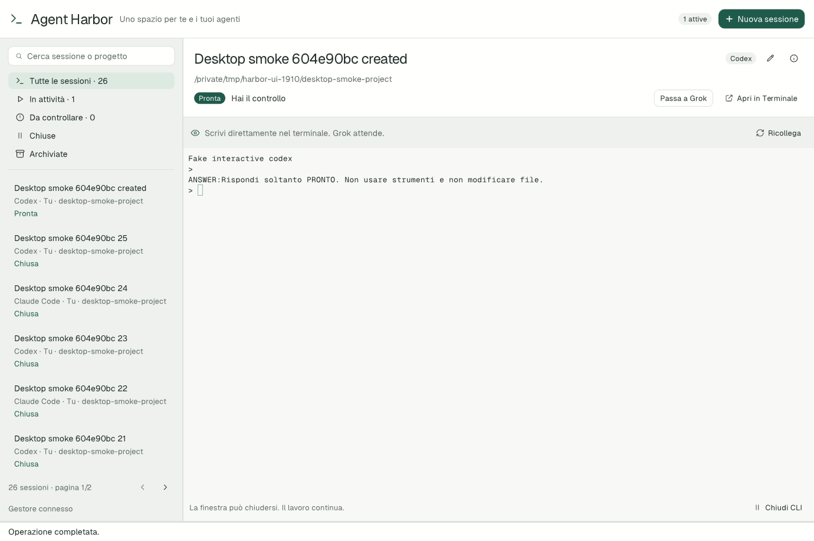

# Agent Harbor

[](https://github.com/TommyBez/agent-harbor/actions/workflows/ci.yml)

A native macOS workspace for persistent Claude Code and Codex sessions, shared between you and Grok Bot.

Harbor keeps the original interactive CLIs in dedicated tmux sessions. Use the desktop app to find a conversation, observe its terminal, take control, or resume it after the CLI exits. Bots use the same local controller through a JSON-speaking command-line interface. Multiple sessions of either provider can run independently.

**Status:** early experimental release. The UI uses Native SDK **0.6.2**, pinned in the lockfile. This is not a claim that every CLI feature or crash-recovery scenario has been certified. See [capability boundaries and the verification matrix](docs/CLI-PARITY.md).

The first [verification checkpoint](docs/VERIFICATION.md) passed with two Codex and two Claude Code conversations: project analysis, actual tests, process exit and exact-conversation resume with recovered context. The result was observed in Grok Bot. Separate packaged-app checks exercised the actual interface with a fake provider.

## Requirements

- macOS; the first release targets the native desktop workflow on Apple silicon.
- Node.js 24 or later for source development and the standalone Harbor CLI. The packaged desktop app includes its Node runtime.
- pnpm for source development; the exact package-manager version is declared in `package.json`.
- tmux available locally.
- Original `codex` and `claude` CLI installations, authenticated through their normal login flows.
- A local project you are authorized to use with the selected CLI.

Native SDK is a pinned development dependency. Run commands through pnpm so the project-local SDK is used. CLI accounts, authentication, billing and provider terms remain separate from Harbor. A project may still require the provider's normal trust or permission confirmation.

## Develop

```sh
pnpm install
pnpm doctor
pnpm build
pnpm dev
```

`dev` launches the built native binary; run `pnpm build` again after changing native code or markup. If a dependency is not found, `doctor` reports the missing executable. Harbor also checks common installation locations because a desktop app launched from Finder may have a different `PATH` from your shell.

## Validate and package

```sh
pnpm test
pnpm test:ui
pnpm check
pnpm build
pnpm package
```

Backend tests, native model tests, markup validation and a build cover different failure classes. Real CLI and Grok Bot journeys additionally require authenticated local providers and an explicitly selected test project; they are not implied by a successful build.

Packaging is for a local macOS application. A generated bundle must not be described as signed and notarized for public distribution unless its release notes explicitly establish that.

## Bot interface

Run `node bin/harbor.mjs --help` for the current command contract. Commands return JSON; `watch` streams newline-delimited snapshots. `wait` returns when the specified request finishes, requires attention or reaches its timeout.

See [Grok Bot setup](docs/GROK-BOT.md) for portable source/bundle command paths and a copyable bot instruction. Harbor is invoked through Grok Bot's local command execution; it does not require a public server.

For an automated caller, allocate and retain a session UUID before creating it, and retain a stable request ID for each task. Substitute your own session UUID and authorized project path:

```sh
node bin/harbor.mjs create \
  --id 40f3177c-95c2-47e6-a960-6833667fd203 \
  --provider codex --project /absolute/path/to/project \
  --title "Project review" --owner grok \
  --text "Analyze this project and summarize its test coverage." \
  --request-id review-001

node bin/harbor.mjs wait 40f3177c-95c2-47e6-a960-6833667fd203 --request-id review-001
node bin/harbor.mjs stop 40f3177c-95c2-47e6-a960-6833667fd203 --actor grok
node bin/harbor.mjs resume 40f3177c-95c2-47e6-a960-6833667fd203 \
  --actor grok --text "Continue from your previous findings." --request-id review-002
```

Use `--provider claude` for a Claude Code session. Inspect `ok`, the request state and any error before proceeding; a successful command response may describe work that is still running. A retry uses the same session/request identity and payload. A new task uses a new request ID. Never blindly replay a request reported as uncertain.

Creation also accepts supported original CLI startup options as `--cli-args '["--model","MODEL_NAME"]'` or repeated `--cli-arg` values. Arguments are stored with the session and validated; options that replace Harbor's conversation identity or disable normal trust checks are reserved. See the [startup option boundary](docs/CLI-PARITY.md#startup-options).

### Images from Grok Bot

The bot can pass local images with repeated `--image /absolute/image.png` options on `create`, `start`, `send` and `resume`. For example:

```sh
node bin/harbor.mjs send SESSION_ID --actor grok \
  --request-id visual-review-001 \
  --text "Describe this screenshot." --image /absolute/screenshot.png
```

Image requests use the original CLI's image input and preserve the current conversation. They do not depend on the Mac clipboard or on human keyboard input. Request JSON supports an `images` array, and the result receipt includes image metadata. See [limits, retries and the bot instructions](docs/GROK-BOT.md#images-from-the-bot).

## How it works

```text
Desktop app / Grok Bot
        │
   Harbor client
        │ private Unix socket
   Node 24 daemon ── SQLite state
        │
   private tmux server
        ├── Claude Code session A
        ├── Claude Code session B
        ├── Codex session C
        └── ...
```

Closing the app detaches its view. An explicit stop requests normal CLI exit and preserves the conversation record. Resume uses that conversation's exact native ID. The desktop list is searchable and paged, while only the selected terminal is attached for display.

Control is explicit: a session belongs to the human or to Grok. Watching a bot's terminal does not take control. Requests have stable IDs so a caller can retrieve a result after a retry. Uncertain delivery after a crash is surfaced rather than blindly replayed.

The original CLI remains responsible for tools, permissions, project trust, user settings, skills, plugins and MCP servers. Harbor adds observation and lifecycle management. It does not bypass approvals or replace the CLI with a headless API. See [the architecture](docs/ARCHITECTURE.md).

## Paste an image

Take control of the session, focus its terminal and use **Ctrl+Shift+V** with an image copied to the macOS clipboard. Wait for `[Image #1]`, add your prompt and press Enter. This was verified with a PNG copied from Preview in both Codex and Claude Code. **Cmd+V and Ctrl+V currently do not attach images** in the embedded terminal; Native SDK 0.6.2 consumes those shortcuts as text paste. Drag/drop and other clipboard sources remain unverified. See the [test evidence](docs/VERIFICATION.md#image-clipboard-partial-live-pass).

## Local state and privacy

Runtime data is stored outside the source checkout, by default in:

```text
~/Library/Application Support/Agent Harbor/
```

This includes the SQLite registry, Unix sockets, process journals and local logs. `HARBOR_HOME` can select an isolated state directory for testing. Keep runtime directories, transcripts, credentials and machine-specific configuration out of version control. Harbor has no public network listener; the local boundary is the current OS account.

The coding agents still communicate with their configured providers and may access tools according to their own configuration and permissions. “Local controller” does not mean that provider inference happens locally.

## Design and project documentation

- [Mobbin UX research](docs/UX-RESEARCH.md): eight focused searches, 24 inspected screens, interaction decisions and accessibility requirements. References are linked; proprietary screenshots are not redistributed.
- [Architecture](docs/ARCHITECTURE.md): identities, persistence, ownership, recovery and test coverage.
- [CLI capability preservation](docs/CLI-PARITY.md): tested-versus-expected boundaries and same-session terminal fallback.
- [Grok Bot setup](docs/GROK-BOT.md): integration paths, bot instructions, ownership and retries.
- [CLI startup options](docs/STARTUP-OPTIONS.md): supported argument arrays, worktrees and lifecycle boundaries.
- [Verification record](docs/VERIFICATION.md): real-provider evidence, automated checks and unresolved capabilities.
- [Native SDK skill provenance](docs/NATIVE-SKILLS.md): pinned upstream implementation guidance.
- [Contributor instructions](AGENTS.md): invariants and validation expectations.



*Actual application screenshot from the isolated desktop UI test: 26 session records, one fake provider, zero real AI launches. The terminal content is test output, not a real Codex or Claude response. The screenshot is unmodified.*

## License

Apache-2.0. See [LICENSE](LICENSE). Third-party runtimes, CLIs and dependencies retain their own licenses and terms.
