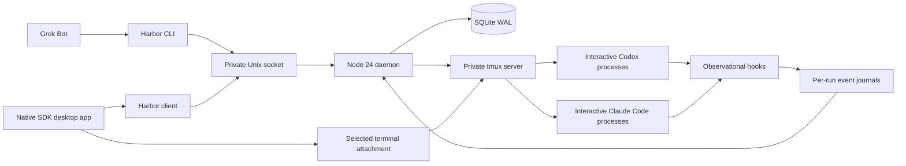

# Architecture

Agent Harbor is a local desktop controller for persistent, interactive Claude Code and Codex sessions. Its durable unit is a conversation, not a window or a provider. Multiple sessions of either provider can exist at once.

This document describes the intended contract and the implementation being assembled for the first release. Test results belong in release verification evidence; this document does not certify runtime behavior merely because a component is present.

## Component boundaries



- The desktop app owns presentation, selection and terminal rendering. It does not own the lifetime of an agent process.
- The Harbor CLI and desktop client call the same controller. Grok Bot uses the CLI's structured JSON responses.
- A single Node 24 daemon is the SQLite writer and serializes mutations for each session. A dedicated Unix domain socket provides local IPC. There is no public HTTP listener.
- A private tmux server owns the original interactive CLIs. A session can remain alive with no GUI attached.
- Observational hooks write per-run journals even if the daemon is unavailable. The daemon imports new complete records incrementally into SQLite.
- The visible terminal attaches to the selected session. Switching the selected session detaches the view; it does not stop the agent.

## Native SDK boundary

Native SDK is pinned to **0.6.2**, including its upstream project skills. It is an experimental dependency. Pinning prevents an unreviewed upgrade; it does not establish long-term ABI stability, terminal parity or production maturity.

Keep business state and process management outside the UI runtime. A Native SDK crash should affect presentation and its attachment, not the durable session registry or agent process. The app must restore its selected view from controller state after restart. Updates require native model tests, markup validation, a build and real native UI verification. See [the upstream skill provenance](NATIVE-SKILLS.md).

The first interface uses a compact session feed, a searchable list paged in groups of 20, and one selected terminal attachment. Historical or off-screen sessions do not each allocate a terminal renderer. Pagination is presentation, not a limit of 20 sessions. Runtime cost still grows with active CLI processes; “N sessions” is not a promise of unlimited hardware capacity.

The native watcher runs `watch --compact --include-archived --chunked`. Its output is framed as `snapshot-begin`, one or more `snapshot-chunk` records and `snapshot-end`, all bearing a snapshot ID. Each line has a bounded size. The UI commits the assembled list only at the matching end frame, so a partially read snapshot cannot erase the list or change pagination halfway through. This framing exists at the CLI/native-reader boundary; the daemon's IPC watch still transmits a complete JSON snapshot under its response-size limit. It is not an unlimited streaming registry.

## Identity model

| Identity | Lifetime | Purpose |
|---|---|---|
| Harbor session UUID | Conversation | Stable public handle used by UI and bots |
| Provider native session ID | Provider conversation | Exact resume target; never substituted with “latest” |
| Run UUID | One process launch | Isolates hook events and process state across restarts |
| Native turn ID | Provider turn | Correlates accepted prompts and final output |
| Request ID | Caller operation | Deduplicates a retry and allows result retrieval |

Provider is a session attribute, not its primary key. New sessions always receive distinct Harbor identities. Each process launch receives a new run identity and a corresponding tmux session. A resumed conversation keeps its Harbor and native IDs while its run identity and process ID change.

Claude can be given a new native conversation UUID at launch. Codex's native ID is learned from qualifying runtime events. A recorded native ID is pinned; a mismatching event cannot silently replace it. A session without verified native identity must surface a recovery problem rather than resume an arbitrary conversation.

## Data and local IPC

Default state is outside the checkout:

```text
~/Library/Application Support/Agent Harbor/
  harbor.sqlite
  harbor.sqlite-wal / harbor.sqlite-shm
  daemon.sock
  tmux.sock
  config.json
  logs/
  attachments/<sha256>.<extension>
  runs/<run-id>/events.jsonl
```

`HARBOR_HOME` can select an isolated state directory for tests or a separate installation. It must be a real directory owned by the current OS user; permissions are restricted to that user. The directory and socket location must satisfy the Unix socket path-length limit. SQLite and socket files receive restrictive permissions.

The current schema is **version 5**. It separates sessions, process runs, requests, imported events and lifecycle audit records. Session records include supported startup arguments and the observed working directory. Runs pin their primary tmux pane, and record their purpose (a CLI or Harbor's trust helper) and the workspace-trust dialog they showed. Explicit migrations upgrade version 1 through versions 2, 3 and 4 to version 5; an unknown newer schema or corrupt database is an error, not permission to delete and recreate user state. SQLite WAL supports durable transactions and integrity checks.

The version-1 migration cannot reconstruct original request text that was never stored: legacy request hashes retain their old normalized representation. New requests store both an original-payload hash and a separate correlation hash. Retrying a legacy request with formatting differences may return a conflict; it must not replay the prompt to resolve that conflict.

IPC uses bounded, newline-delimited JSON messages with request identities. The watch connection streams compact snapshots when their contents change. Malformed requests, unsupported commands and dependency failures return structured errors. Clients must display a connection error rather than invent an empty registry when the daemon cannot be reached. The controller is a coordination mechanism for processes belonging to one OS account; it is not a security boundary against another process already running as that account.

## Launch and settings preservation

Harbor launches the installed **interactive** CLIs through argument arrays. It does not substitute a headless SDK, `codex exec`, `claude --print`, an alternative configuration home or a permissive sandbox mode.

- Codex runs with its normal interactive interface, a selected working directory, an invocation-local observer configuration and an exact `resume` ID when applicable.
- Claude Code receives a new `--session-id` or exact `--resume` ID and an invocation-local observational hook settings file.
- The first task is passed as the original CLI's positional prompt, removing the need to type a bootstrap prompt manually. When no task is supplied, a small initialization turn establishes observable readiness.
- CLIs run with the user's login-shell `PATH`, resolved once per controller start, so hooks, MCP servers and tools that their configuration runs by name work as in a terminal even when the app was opened from Finder. tmux takes a new pane's `PATH` from the creating client, so Harbor sets it there.
- User login, approval policies, skills, plugins, MCP servers and other CLI settings remain owned by the CLI. Harbor does not write global configuration or grant tool permissions on behalf of the user.
- Workspace trust is answered in the CLI's own dialog, either by the human from Harbor or automatically inside folders the human pre-authorized. The CLI records the decision itself. See [workspace trust](WORKSPACE-TRUST.md).

Attention means a human has to act, so Harbor raises it only on evidence of that:
- A permission request alone is not enough, because a reviewer or another hook may answer it. Claude reports a dialog that is really waiting through its `permission_prompt` notification. For Codex, Harbor asks the human once a `PermissionRequest` has had no follow-up for 6 seconds. A later tool result, failure or auto-mode denial clears it. Known limit: a Codex command that its reviewer approved and that runs longer than 6 seconds is shown as needing attention until it finishes, because Codex reports nothing in between.
- After an interrupt or a transient API error (`overloaded`, `server_error`, `max_output_tokens`), the CLI is back at its prompt. The session is `ready` and the request keeps the outcome. Usage limits (`rate_limit`, which can open Claude's usage-limit menu), a context that needs `/compact` (`invalid_request`), and account or credential failures still need the human.
- A hook's `cwd` is the CLI's current directory, not an identity. Sessions marked `HOOK_PROJECT_MISMATCH` by releases up to 0.1.3 after a `cd` recover on the next controller start, and the events dropped then are imported again when nothing was accepted after them. Claude moves it with the Bash tool's `cd`, `--add-dir` folders and worktrees, so only the first event of a Claude run must come from the launch directory. Codex keeps one directory per session, so a different one there remains an incident. A worktree is learned only from a different checkout of the same repository: its root, or the project's own position inside it (Codex keeps that).
- Scheduled crons do not hold a finished turn open; running background tasks do. A new Claude prompt while the previous turn never stopped (an Esc interrupt fires no hook) ends that request with `TURN_SUPERSEDED`.

Observational hooks are additional instrumentation, not an approval policy. They return an empty object and do not grant or reject tool actions. Existing user/project hooks must remain effective; invocation configuration merging needs runtime verification for each supported provider version. A Codex hook review is a trust dialog (`HOOK_TRUST_REQUIRED`): answered like folder trust. A managed policy that prevents observation is surfaced as attention required. No trust-bypass flag is used.

### Original startup arguments and worktrees

`create` accepts a JSON array through `--cli-args` or literal values through repeated `--cli-arg`. The argument parser validates provider-specific options, stores the array on the session and reconstructs argument arrays for every launch. This is a supported-option interface, not arbitrary shell text or an unrestricted pass-through. Identity, resume, headless/remote modes, hook replacement and permission-bypass options are reserved. Unsupported options fail explicitly. See [the capability boundary](CLI-PARITY.md#startup-options).

Provider worktree options are supported during the first launch. A qualifying hook can establish a changed working directory only when it belongs to the same Git repository, verified through its common Git directory. Harbor saves that directory and omits the worktree-creation option on resume so it does not create a different worktree for the same conversation. If the saved directory is missing, resume returns `WORKTREE_MISSING`; it does not switch silently to the original project. Harbor does not delete the provider's worktree when stopping or archiving a conversation. Claude refuses `--worktree` before workspace trust; Harbor then shows the trust dialog in a conversation-free helper and repeats the identical first launch ([details](WORKSPACE-TRUST.md#worktrees)).

## Requests, retries and ambiguous delivery

The controller persists an operation intent before sending bytes or launching a process. A request progresses through delivery, observed prompt acknowledgement and terminal outcome. The request ID allows a bot to ask for the same result after losing its connection.

Request identity must compare the original payload. Any normalization used to correlate a pasted prompt with a CLI hook is a separate concern and must not let a reused request ID identify different text. Different payloads under the same request ID are conflicts.

Exactly-once terminal delivery cannot be guaranteed across an arbitrary crash between writing bytes and recording acknowledgement. Such a request is uncertain. Recovery reconciles the journal and process state; it does **not** replay uncertain input automatically. The caller can inspect the request and terminal, then decide how to proceed. A timeout does not mean the prompt was never delivered.

Observed `UserPromptSubmit` means the prompt reached the hook boundary. Another hook or a provider policy may still reject it. A process being alive is not evidence that its composer is ready. Human attention, interrupted turns and missing observations must remain distinguishable from success.

### Per-request images

Requests carry an optional ordered list of local image paths. Before intent/delivery, the controller captures bounded regular files without following final-component symlinks, detects supported headers and creates private content-addressed copies. Each request stores an `images_json` manifest. Its payload hash combines exact text, source paths, image hashes and ordering; text-only hashes keep their previous representation. A version-4 migration adds empty manifests to old receipts without changing their identity.

Native image delivery is provider-specific: Codex initial/resume flags, separately pasted paths in the active Codex composer, and Claude quoted file mentions. Staged paths never become shell source. Live Codex delivery checks attachment markers in the current composer before entering text, then fences ownership again before Enter. The observer matches Codex's image-number prefix only against a pending request whose manifest has that exact image count. It does not strip markers indiscriminately from ordinary text-only requests.

The private copies remain outside the repository and are retained with history; no automatic garbage collection is implemented yet. The host OS clipboard is never used. Clients probe `capabilities.requestImages` to reject an older daemon that would otherwise ignore unknown image fields. Native hook acknowledgements and completion remain authoritative; attachment markers only confirm composer preparation. Provider settings and native image-decoding errors remain visible.

## Ownership and terminal clients

The owner is explicit and independent of agent activity: `human` or `grok`. Session mutations are serialized. Input submission checks the current owner before delivery. An internal control epoch increments on ownership changes and is rechecked before submitting a prepared input. A bot cannot continue sending merely because it previously owned the session. A changed epoch leaves a draft to inspect rather than silently submitting it.

The primary pane ID is pinned per run. Bot paste, submission, exit requests, liveness and screen capture target that pane even if an agent opens additional tmux panes. The human terminal attaches to the tmux session as a whole. A split pane or teammate must not become the main conversation merely because it is currently selected.

Taking control and returning control must coordinate the persistent owner with tmux client writability. When Grok owns a session, terminal viewers attach read-only and do not compete to resize the writer. A failed attempt to make a viewer read-only must be handled visibly or detach that viewer; it must not leave a hidden second writer. A newly attached client is subject to the same policy.

The native UI must keep “observe” and “take control” separate. Taking control does not cancel a task already delivered to the CLI. Returning control should happen only when the human interaction has reached a safe boundary. Concurrency tests must exercise send/takeover/release races, failed client updates and stale callers. The initial API does not imply a multi-user authorization model.

## Lifecycle and recovery

| Operation | Contract |
|---|---|
| Create | Allocate a new conversation record; optionally start its first task |
| Start | Launch an unstarted session, or recover its verified saved conversation |
| Send | Submit one correlated task to the existing ready process |
| Stop | Request normal CLI exit and verify actual process termination |
| Resume | Launch a new process targeting the exact saved native conversation |
| Close window | Detach presentation while leaving processes alive |
| Archive | Remove a stopped session from the default list while retaining its record |
| Restore | Return an archived conversation to the normal list without creating a new identity |

Stop does not silently force-kill a busy or unresponsive CLI. A timeout leaves an actionable state and an honest error. Repeated stop requests must not insert multiple `/exit` strings into an unrelated composer.

A client never keeps using the controller of an older release. Before its first request, a client compares its version with the one `doctor` reports. If the running controller is older, the client asks it to `shutdown`, then starts its own. The controller refuses while a session operation is in progress (`DAEMON_BUSY`) and refuses any caller that is not newer (`DAEMON_NOT_OLDER`), so mixed installations cannot stop each other in turn. Releases before 0.1.2 report no version and cannot be asked; the client sends them SIGTERM, their normal shutdown. CLIs live in tmux, so replacing the controller leaves them running, and the new controller adopts them.

After daemon restart, reconcile tmux panes, run identities, journal offsets and pending request receipts. After a machine reboot, historical session records remain but process liveness must be rediscovered. Do not claim reboot or power-loss recovery until the corresponding tests have run. Do not auto-resume agents after a reboot without an explicit documented policy.

After a successful new launch, old ended tmux sessions for the same conversation can be pruned only when every pane is dead. Harbor preserves a final screen capture in that run's private directory before removing its dead terminal container. The current run and any container with a live pane are retained. This is dead-terminal cleanup, not deletion of conversation history or Git worktrees.

## Observation and response attribution

Each journal record carries provider, Harbor session ID and run ID. The provider event contributes native conversation and turn identity. Reject cross-session, cross-project and mismatched native identities. Ignore subagent completion events for the primary conversation. Late events from a previous run may be retained as history but cannot complete a new run's request.

Imported event positions are deduplicated. Import only complete records; preserve a trailing partial record for the next read. Limit payload sizes and import work. A corrupt or truncated journal should produce a diagnostic, not a fabricated final response. The terminal screen is useful for human inspection; it is not the machine protocol for deciding which request completed.

## Dependency resolution and packaging

Resolve executables from configured paths and common installation locations in addition to `PATH`; Finder does not inherit every interactive shell configuration. `doctor` exposes which executable paths were found. Never hard-code the developer's home directory or checkout into a published bundle.

A package resolves its own resources relative to the app bundle and stores mutable state in the user's application-support directory. The desktop packager includes the Node runtime, broker and client resources. Source development and the standalone CLI require Node 24; both distribution paths require tmux and authenticated original CLIs. Bundled components need their license notices. An ad-hoc local bundle is not a notarized public macOS release.

## Validation matrix

The following is a coverage inventory. Status distinguishes the [2026-10-17 verification checkpoint](VERIFICATION.md) from remaining work; a partial result must not be reported as a full pass.

| Area | Required evidence | Status |
|---|---|---|
| Identity isolation | Multiple sessions of one provider, late events, foreign IDs and subagent events | Automated pass: four concurrent fake conversations keep distinct native IDs/output; foreign native identity remains an incident and subagent completion cannot finish a parent turn. Exhaustive late-event permutations remain unverified |
| Request identity | Same-ID retry, different-payload conflict and concurrent duplicate submission | Automated pass: create/send retries reuse saved identities, changed payloads conflict, and a simulated lost launch response retries without duplication. Concurrent same-request race coverage remains incomplete |
| Crash boundaries | Intent persisted before delivery; crash after delivery never blindly replays | Automated pass: daemon SIGKILL recovery preserves four live fake processes and native IDs; takeover during prepared input leaves an uncertain request. Arbitrary crashes at every delivery boundary remain unverified |
| Persistence | SQLite reopen/integrity, daemon restart and journal reconciliation | Automated backend checks passed; controlled replacement by the bundled daemon adopted four live CLI processes unchanged; arbitrary crash timing remains unverified |
| IPC resilience | Concurrent clients, malformed/oversize payloads, stale socket and safe state directory | Automated pass: concurrent malformed/oversized/partial requests are bounded and daemon remains usable; silent-peer timeout, quiet watch, private directory/socket modes and stale-lock recovery pass. This is not exhaustive hostile-client coverage |
| Ownership | Wrong-owner rejection, takeover races and client read-only failure | Wrong-owner rejection and complete human UI → Grok follow-up path passed on both providers; exceptional races remain separate |
| Multi-session scale | Concurrent fake CLI processes, many stored records and bounded UI work | 1,000-record metadata benchmark observed; sustained real-agent load pending |
| Real providers | At least two Codex and two Claude sessions with distinct native identities | Passed: four real sessions analyzed fixture and ran 2/2 tests each |
| Real lifecycle | Window reopen, actual CLI exit, exact-ID resume and recovered context | Four real CLI exits/resumes and GUI persistence passed; final bundled daemon adopted four live processes; isolated UI lifecycle passed with a fake provider |
| Real Grok path | Bot creates, sends, receives, stops and resumes both providers | Passed in the tested bot scenario: successful four-session result visible in real Grok Bot chat |
| Permissions/hooks | Existing settings/hooks retained; new-project trust and tool prompts visible | Codex hook-registry aggregation verified; Claude merge documented; broader execution/policy coverage pending |
| Native UI | Creation, selection, search, pagination, control, stop/resume and error states | Real terminal selection/input passed; isolated eight-check UI smoke passed for pagination, search, form, rename, stop, archive and restore, and passed again on the 2026-10-19 redesigned interface with fake providers; other cases remain bounded by that evidence |
| Terminal capabilities | Resize, alternate screen, keys, paste, Unicode, IME, image clipboard and fallback | Specific multiline/accent/emoji inputs passed; external attachment confirmed; broader terminal features pending |
| Package | Launch outside checkout with Finder-like environment | Finder launch without custom environment and isolated packaged-app UI smoke passed; clean-machine installer/notarization not tested |
| Public repository | Clean install/checks, secret/path/runtime scan and documented license provenance | Public source and uploaded commit verified; source scan and provenance checked; remote install/build results are reported by [CI](https://github.com/TommyBez/agent-harbor/actions/workflows/ci.yml) |

See [CLI capability boundaries](CLI-PARITY.md) and [Mobbin UX research](UX-RESEARCH.md).
