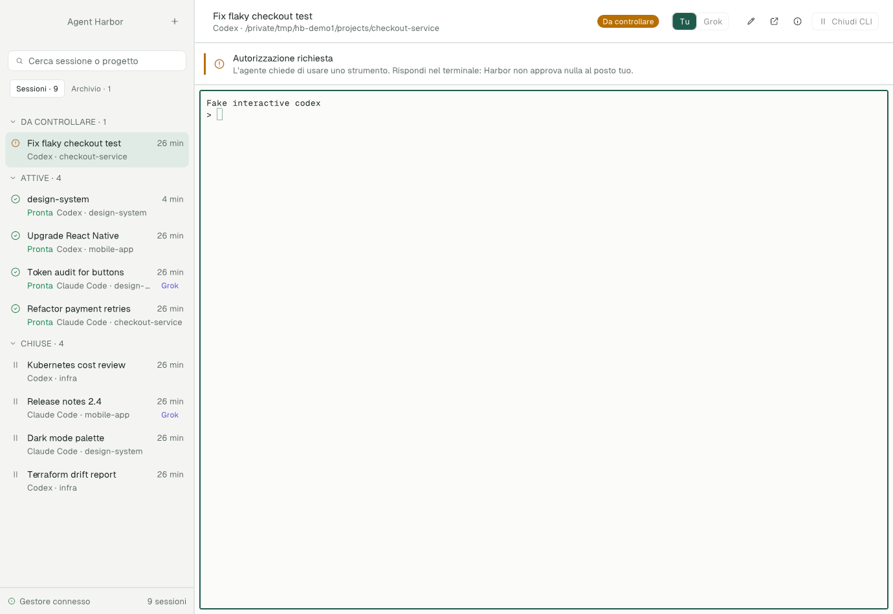
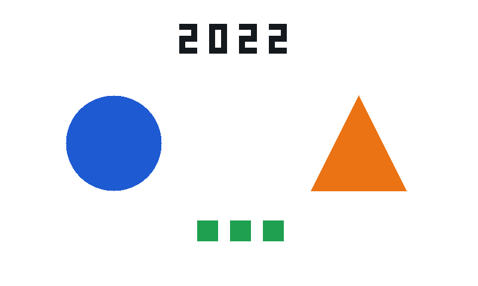

# Verification record

Date: **2026-10-17**. This is the first-release verification checkpoint. It separates real provider behavior, automated component tests, native UI observations and unverified capabilities. The real Grok Bot response, packaged-app observations and isolated desktop smoke test below have been confirmed. The source is published at [TommyBez/agent-harbor](https://github.com/TommyBez/agent-harbor); repository visibility and the uploaded source commit were read back after publication. External Terminal interaction remains a separate boundary.

## Four real interactive CLI sessions: passed

The live scenario used the installed original **Codex 0.162.1** and **Claude Code 2.1.302** CLIs: two independent conversations from each provider. Normal trust and permission prompts remained effective.

The [sanitized machine-readable summary](evidence/live-2026-10-17.json) records the completed scenario. Private transcripts, prompts, markers, project paths, native IDs, request IDs, process IDs and the experiment UUID are deliberately excluded from that public artifact.

| Session | Real fixture tests | Human ownership enforced | Actual exit | Exact conversation resumed | New process | Marker recalled without tools |
|---|---|---|---|---|---|---|
| Codex 1 | 2/2 passed | Passed | Passed | Passed | Passed | Passed |
| Codex 2 | 2/2 passed | Passed | Passed | Passed | Passed | Passed |
| Claude 1 | 2/2 passed | Passed | Passed | Passed | Passed | Passed |
| Claude 2 | 2/2 passed | Passed | Passed | Passed | Passed | Passed |

What the runner checked:

- Each conversation analyzed the local invoice fixture and ran its two Node tests. The runner required a matching native tool event with successful test output; an assistant's assertion alone was insufficient.
- Each conversation received a distinct marker. Session and native-turn correlation kept their answers separate.
- While a session belonged to the human, a Grok-actor send was rejected. The runner then returned control through the controller.
- All four original processes exited. At one recorded checkpoint all four old PIDs were absent together, rather than merely detached from a terminal.
- Resume kept each original native conversation ID and produced a different process. The follow-up prompt contained neither the expected marker nor the expected test answer.
- All four resumed conversations recalled their marker and the test result. No tool invocation was observed in those recall turns.
- The fixture remained unchanged.

The scenario completed at **17:00:34 UTC**. It is checkpointed so a retry continues the recorded operation rather than creating duplicate conversations. See [live-test instructions](../test/live/README.md) and [the runner](../test/live/scenario.mjs).

The local runner proves the controller and original-CLI lifecycle. The real-bot presentation was separately confirmed: Grok Bot's **Codex Lab** conversation displayed its final successful result for all four sessions at **19:01:49 Europe/Rome**. This observation is separate from the machine-readable runner summary.

## Automated checks at this checkpoint

The final local checks recorded **30/30 backend tests** with zero skips and **15/15 native model tests** passing. Source/markup checks, the final rebuild containing the parser fix and packaging checks also passed. These are local results. [GitHub Actions](https://github.com/TommyBez/agent-harbor/actions/workflows/ci.yml) separately runs the backend on Linux and macOS, plus native UI tests, checks, build and packaging on macOS; consult the run for the exact commit's remote result.

The [remote run for implementation commit `a804fb5`](https://github.com/TommyBez/agent-harbor/actions/runs/39052726604) passed both jobs, including native tests, a clean macOS build and packaging. The Linux suite excludes the macOS-specific PTY test; that test runs in the macOS job.

Backend coverage includes request identity, event attribution, control boundaries, startup-argument validation, persistence and fake-process lifecycle cases. Native model tests exercise the application state and list behavior; they do not substitute for operating the actual window.

### Metadata scale measurement

The local compact-list benchmark with **1,000 stored synthetic session records** measured approximately **18–19 ms p95** at this checkpoint. It started **zero AI agent processes**. The number describes metadata enumeration in the test harness, not 1,000 concurrently running agents, terminal redraw latency or a cross-machine performance guarantee.

The watch test also exercises a large stored registry and suppresses unchanged snapshots. See [the scale tests](../test/backend/scale.test.mjs) for fixture construction and measurement boundaries. The GUI renders a page of 20 rows and attaches the selected terminal; the overall process workload still depends on the actual number of active agents.

## Native UI and package evidence

| Path | Current evidence | Remaining boundary |
|---|---|---|
| Native window displays real CLI | Actual provider terminals rendered; 12 real session switches preserved usable rendering and input | Broader terminal feature matrix remains unverified |
| Window close/reopen | All four CLI PIDs survived GUI closure/reopen; the final build connected to those existing processes | Machine reboot and power-loss recovery remain unverified |
| Sidebar filters/search/pagination | Isolated real-UI smoke passed: two pages expose 25 seeded names, search selects the exact session, archive/restore preserve identity and actions | Other edge cases remain outside this eight-check scenario |
| New-session form | Actual UI validation and empty-prompt creation passed with a fake provider; its response rendered and rename persisted | This form test does not launch or certify a real AI provider |
| Human/bot control UI | Human input through the UI and the UI return-to-Grok action passed on Claude 2 and Codex 2; Grok received both follow-up answers with unchanged native IDs and PIDs | Exceptional handoff/crash cases remain outside the observed sequence |
| External Terminal fallback | UI button opened a second tmux client attached to the existing Codex 2 session, while its original agent process remained the same | External typing, menus, clipboard/IME and the full return-to-bot journey unverified |
| Packaged application launch | Package revision 3 launched from Finder without custom environment variables; isolated state/controller UI smoke also passed | Not a clean-machine installer or notarization test |
| Real Grok Bot chat | Final successful result for all four sessions visible in the real Codex Lab bot conversation at 19:01:49 Europe/Rome | This evidence covers the tested local bot and scenario |
| Final bundled controller adoption | The final app launched normally with four active sessions; a replacement daemon using bundled Node/controller resources adopted all four existing CLI processes without changing their PIDs; RPC readback confirmed all four alive and ready | This is controlled daemon replacement, not power-loss or every crash-boundary recovery |

The human-input test used a multiline paste containing accented text and an emoji, `caffè 🚢`, in both selected providers. Each returned the expected `HUMAN_UI caffè 🚢` marker and the remembered `TESTS 2/2` result. Native conversation IDs and process IDs stayed unchanged. This demonstrates those specific paste/content cases and continued conversation identity; it does not certify arbitrary Unicode cursor behavior, every input method or image clipboard support.

The user-facing **Passa a Grok** action then returned both sessions to the bot. Grok submitted follow-ups using stable request IDs and the `terminal-paste` transport. The prompts did not include the expected marker. At **19:10:21 Europe/Rome**, the real Codex Lab bot conversation displayed both replies containing the human-entered marker and `TESTS 2/2`. Both native conversation IDs and CLI PIDs remained unchanged. This completes the observed human → native UI → Grok → same-conversation response path for one session of each provider.

A subsequent controller test used the final bundle's Node runtime and broker to stop and resume one real conversation per provider. Claude completed immediately. Codex displayed normal review for the seven observer hooks because their command paths had changed from the source checkout to the bundle. With the user's existing project/hook authorization, those hooks were reviewed and trusted in Codex's own UI. The first unobserved turn was not replayed automatically; after normal exit, a new request resumed the same conversation and completed without further intervention at **17:18:19 UTC**. Both providers recalled the original marker and `TESTS 2/2`. This is packaged-controller evidence, separate from the earlier real Grok chat scenario.

For the external Terminal action, controller/tmux inspection confirmed the additional attachment to the same existing session and agent process. The UI automation tool did not permit control of Terminal.app, so this check stops at verified attachment. No external keystroke, menu or clipboard success is claimed.

The real-provider GUI observations above are evidence from the implementation session. The separately published screenshot below comes from the isolated fake-provider UI test, not from a real AI conversation. There is no claim of notarization or a signed public installer.

## Isolated desktop UI smoke: 8 checks passed

The packaged app was exercised in a dedicated, isolated state directory. The scenario began with 25 stopped synthetic session records, then created one additional session through the actual native UI. It launched **exactly one fake interactive provider and zero real AI providers**. All 26 sessions were stopped at the end; none of the seeded records unexpectedly started.

The [sanitized smoke report](evidence/desktop-smoke-2026-10-17.json) records eight passed checks:

1. The running UI connected to the dedicated registry.
2. Both pages exposed all 25 seeded names and the correct disabled navigation controls.
3. Search selected the exact Grok-owned session and kept its unauthorized resume action disabled.
4. Form validation and empty-prompt creation launched the fake provider and displayed its response.
5. Renaming through the UI persisted on the same session identity.
6. Closing through the UI exited the fake CLI normally while preserving its conversation.
7. Archiving and restoring preserved identity and available actions.
8. Final inventory confirmed 26 stopped sessions, one fake launch and no seeded-session launches.

The smoke completed at **17:08:16 UTC**. The runner recorded six screenshots and accessibility snapshots and parsed the UI state for its assertions. The report was reviewed; only screenshot 04 was visually inspected. The report retains the local evidence filenames, and only that selected screenshot is redistributed here. Private session identifiers and process identifiers were removed from the published report. A readback also confirmed the UI request directory had mode `0700` and its request JSON had mode `0600`.

*Actual application screenshot from the isolated UI test. The terminal shows a fake provider; it is not real Codex or Claude output. The image is copied unchanged.*

See [the desktop smoke runner](../test/live/desktop-smoke.mjs) for its isolation and zero-real-provider checks. This test covers UI behavior and local process coordination, complementing the separate four-real-provider scenario above.

## Redesigned desktop UI: 2026-10-19 checkpoint

The desktop interface was redesigned: a unified titlebar header, triage sections in the sidebar, a **You / Grok** control segment, contextual attention and observation banners, a details inspector, a guided new-session form, light/dark palettes, context menus and Command shortcuts. This checkpoint ran a **development build** (`pnpm build`, automation enabled) against isolated `HARBOR_HOME` directories with the fake provider. **No real AI provider was launched.** The interface language then changed from Italian to English; the smoke and model tests below were rerun with the English labels. Earlier evidence in this document quotes the Italian labels that were current at the time.

- The [desktop smoke runner](../test/live/desktop-smoke.mjs), updated for the new labels, passed all **8 checks** on a fresh home: 25 seeded names across two pages, search and Grok-owned disabled resume, form validation and empty-prompt creation, rename, normal close, archive/restore and final inventory. The [sanitized report](evidence/desktop-smoke-2026-10-19.json) omits session and process identifiers.
- Native model tests passed **21/21**, including new coverage for section ordering, collapse and search, default selection, relative times, shortcut mapping, notice lifetimes, context-menu targeting, live appearance changes re-theming the shell and terminal colors, and header alignment from window chrome. Markup checked against the refreshed model contract.
- Additional automation on a demo home exercised the attention banner for a real permission request from the fake CLI, the Grok observation banner, the inspector, creation through the form, Command shortcuts (`native automate shortcut`), Cmd+F focus followed by typing into search, and a row context-menu rename. Every snapshot reported `dispatch_errors=0`.
- The dark palette was inspected through a temporary build that forced the dark scheme; the shipped build follows the system appearance through the same message path the model test drives. Switching the actual macOS appearance was not exercised.
- The rebuilt package was launched on an isolated demo home and its real window captured with the traffic lights. That capture showed header content about 7 pt below the lights because the reported titlebar band is taller than the light row; headers now center on the traffic-light frame, and a second capture confirmed the alignment. The same package then passed the 8-check desktop smoke against another isolated home.

The same session found a controller defect: under a non-UTF-8 locale (`LANG`/`LC_CTYPE` unset, common for Finder-launched apps), tmux 3.6b rewrites the tab separators in `-F` output to `_`. Every pane then looked dead, so live sessions displayed as closed and no terminal attached. tmux output now uses a printable separator, and a run whose stored pane ID carries the escaped form recovers through its primary pane. A regression test reproduces the locale and failed before the fix.

*Development build in an isolated demo registry with the fake provider: a permission request in the attention section, a Grok-owned session and the selected terminal. The terminal shows fake test output, not a real Codex or Claude response. The image is copied unchanged.*

## Hook configuration compatibility audit

Codex's ordinary effective configuration and its hook registry are distinct views. An isolated **Codex 0.162.1** app-server probe requested only initialization, `config/read` and `hooks/list`; it did not create a conversation or invoke a model. The fixture declared a user hook file, a user inline hook, a project inline hook and an invocation `-c` hook for the same event.

`hooks/list` retained all four definitions with their respective sources. They remained untrusted: no hook was executed or automatically approved. `config/read` showed only the higher-priority invocation array, which would have been misleading if used alone to infer hook execution. The result agrees with [Codex's documented aggregation across hook sources](https://learn.chatgpt.com/docs/hooks?surface=cli#where-codex-looks-for-hooks).

For Claude Code, current primary documentation establishes that hook entries combine across settings scopes and that `--settings` supplies an invocation-only settings level. See [Claude settings precedence](https://code.claude.com/docs/en/settings) and [Claude hooks](https://code.claude.com/docs/en/hooks). This is **documentation-backed compatibility**, not a new local Claude hook-execution test.

This audit does not certify every user hook, managed policy or event. Representative existing hook execution alongside Harbor's observer remains a separate live validation item. Manually copying all user hooks into the invocation override would risk duplicate execution and is not required by this evidence.

## Image clipboard: partial live pass

An additional test exercised the packaged app at commit `6ae3191`, Native SDK **0.6.2**, Codex **0.162.1** and Claude Code **2.1.302** on macOS Apple Silicon. [Sanitized evidence](evidence/image-paste-2026-10-17.json) records the exact responses and boundaries.

The test generated an 800×480 PNG containing an unpredictable four-digit number, a blue circle, an orange triangle and three green squares. The image was opened in Preview, all pixels selected and copied with Cmd+C. The test prompt supplied no image path, expected number, shape, color or count. Each CLI created its own clipboard attachment. The neutral prompt asked each to describe the attachment without tools or file reads.

| Shortcut in Harbor's focused terminal | Codex | Claude Code |
|---|---|---|
| Cmd+V | No image attached | No image attached |
| Ctrl+V | No image attached | No image attached |
| Ctrl+Shift+V | `[Image #1]` appeared; correct visual answer | `[Image #1]` appeared; correct visual answer |

The Native SDK automation delivered keyboard events through the real retained terminal input path with the actual macOS clipboard. Codex's native transcript contained an `input_image` block; Claude's contained an `image` block. Both identified **2022**, the blue circle, the orange triangle and three green squares, with **zero tool calls** in their image turns. The original native conversation IDs and process IDs stayed unchanged, and both sessions were returned to Grok's control in ready state.

The cause of the shortcut limitation was checked in the installed SDK source: `WidgetKeyboardModifiers.hasCommandModifier()` treats Control and Super as command modifiers; `widgetKeyboardClipboardAction()` classifies both unshifted V chords as paste; `applyCanvasWidgetClipboardShortcut()` consumes the terminal event and reads only text. Adding Shift avoids that clipboard interceptor and lets the CLI process its own image shortcut. No runtime code or dependency was changed in this verification.

Codex displayed observer-hook exit-code-127 warnings during its turn. Its visual answer and embedded image were independently verified in the terminal and native transcript; this test does not establish a fresh broker result receipt or repair those hook warnings. The earlier packaged-controller checkpoint remains a separate observation.

This proves one copied PNG through this route. It does not certify file-copy paste from Finder, screenshots from every clipboard source, multiple images, drag/drop, an external terminal or image delivery initiated by Grok.

## Images from Grok Bot: passed

A subsequent implementation adds per-request image attachments to the machine API. The [sanitized image report](evidence/bot-images-2026-10-17.json) separates real Grok chat, original-CLI, native-history and desktop observations. The [reproduction procedure](../test/live/README.md#image-requests-from-a-real-bot) describes the required checks.

The actual **Codex Lab** bot executed `create → send → stop → resume` once for a new conversation of each provider, using six private request JSON files. Each turn carried a different synthetic PNG with an unpredictable number, a color and a square count. Neither the image answers nor previous numbers were supplied in the prompts. Grok's final message at **20:50:25 Europe/Rome** displayed all six completed responses and the verified lifecycle results.

| Check | Codex | Claude Code |
|---|---|---|
| Image on new conversation | Passed | Passed |
| New image in the same open conversation | Passed | Passed |
| New image after actual CLI exit and exact resume | Passed | Passed |
| Previous image numbers recalled after resume | Passed | Passed |
| Native image blocks, one per turn | 3/3 confirmed | 3/3 confirmed |
| Correlated accepted/completed response returned to Grok | 3/3 | 3/3 |
| Tool calls in these image turns | 0 | 0 |

Readback of receipts and native histories confirmed the image content, matching answers, unchanged native conversation IDs and different resumed process IDs. Both old processes were gone. Each receipt retained its one-image manifest. These checks supplement Grok's own report rather than relying on the report alone.

Separate operator-initiated controller tests passed **two images together** for Claude send, Codex resume and Codex live send. Native histories contained two image blocks for each tested turn, and all visual answers were correct. Those multiple-image tests were not initiated from the Grok chat.

The packaged desktop displayed both bot-created conversations and their final image answers, including recall. Replacing the controller and closing/reopening the GUI preserved all **six** active CLI processes and native IDs. The final source checks passed **37/37 backend tests**, **15/15 native model tests**, syntax/markup validation, native build and package signature verification.

Image delivery uses local files and no shared clipboard. This test starts with files already on disk; downloading a remote image or extracting an uploaded image from another app is a separate upstream operation. Live verification covers PNG, including multiple files and paths with spaces. JPEG/WebP are accepted formats but were not live-tested here. The manual image-paste shortcut limitations in the preceding checkpoint remain unchanged.

## Workspace trust: 2026-10-19 live pass

A bot-started Claude Code session with `--worktree` used to exit within a second ("Workspace trust not yet accepted"), so the human had to run `claude` in a separate terminal. This checkpoint verified the [workspace-trust flow](WORKSPACE-TRUST.md) with **Claude Code 2.1.302** and **Codex 0.162.1**. Each case used a fresh Git repository in a temporary folder, an isolated Harbor home and a bot-owned session whose task was "Reply with exactly OK. Do not use tools."

| Case | Result |
|---|---|
| Codex in a pre-authorized folder | Harbor accepted folder trust, then Codex's review of Harbor's 7 changed observer hooks; answer `OK`, no human action |
| Claude `--worktree probe` in a pre-authorized folder | Helper showed the trust dialog, Harbor selected "Yes" and confirmed, then repeated the launch; worktree created under `.claude/worktrees/probe` and recorded as the working directory; answer `OK` under the original request ID |
| Codex, folder not pre-authorized | `TRUST_REQUIRED`; the bot's `trust` refused with `TRUST_HUMAN_ONLY`; the human `trust` action answered; answer `OK`, owner still Grok |
| Claude, folder not pre-authorized (twice) | Same as Codex. The first attempt showed that a key sent as the dialog appears can be lost; Harbor now waits for the dialog to settle and retries once before verifying the choice |

The 7 accepted hooks were the invocation-local `<session-flags>` entries for Harbor's observer, not repository hooks. Accepting trust stored the temporary folders in each CLI's own configuration, as pressing the keys would have done. The desktop paths were verified through Native SDK automation with fake providers: the **Trust needed** banner, **Always trust ‹parent›**, **Trust folder** for a Claude worktree session and a Codex session (after Harbor skipped Codex's update notice), and **Trust hooks** for a Codex hook review. Each completed under the original request ID without taking control. Automated checks: **50/50 backend tests** and **24/24 native model tests**, plus markup validation and the native build.

## Explicitly unverified

- Full machine reboot, power loss and every crash timing boundary.
- Terminal features beyond the specific text and single-image paste cases above, including Unicode cursor edge cases, IME, other clipboard cases, drag/drop and external editor integration.
- Every CLI startup flag, model, plugin, skill, MCP integration or provider update.
- Real provider worktree onboarding beyond the single Claude trust case above, and all advanced option combinations.
- Claude MCP-server approvals from a repository's `.mcp.json` and other onboarding dialogs: Harbor does not answer them.
- Sustained performance with large numbers of simultaneously active AI agents.
- External Terminal interaction beyond attachment and UI cases outside the recorded scenarios.

The [capability matrix](CLI-PARITY.md) and [architecture validation inventory](ARCHITECTURE.md#validation-matrix) retain these distinctions. A passing ordinary lifecycle does not certify universal CLI parity.
